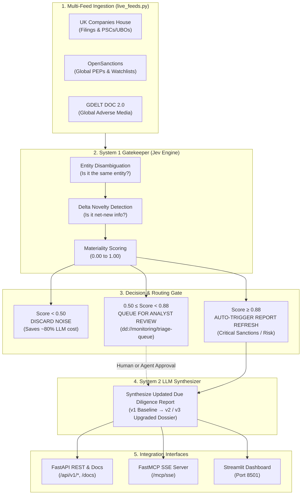

# Perpetual KYC (pKYC) Sandbox

[](https://www.python.org/downloads/)
[](https://fastapi.tiangolo.com/)
[](https://modelcontextprotocol.io/)
[](https://modal.com/)
[](https://streamlit.io/)

A sandbox prototype demonstrating **Perpetual KYC (pKYC)** and continuous monitoring. The system uses a fast **System 1 Gatekeeper (Jev)** to evaluate multi-source feed deltas (corporate registry filings, sanctions watchlists, adverse media) and decide in sub-second time whether newly surfaced information warrants triggering an expensive **System 2 LLM-driven due diligence report refresh**.

The platform provides a **FastAPI REST API**, an integrated **Model Context Protocol (MCP)** server over Server-Sent Events (SSE), and an interactive **Streamlit Dashboard** complete with live telemetry, scenario injectors, and an embedded MCP test console.

---

## 🏛️ System Architecture



---

## 🌟 Key Features

* **Dual-System Architecture**:
  * **System 1 (Jev Fast Gatekeeper)**: Sub-second disambiguation and materiality scoring. Screens out harmless corporate filings, syndicated duplicates, and namesake false positives without invoking costly frontier LLMs.
  * **System 2 (Deep Synthesizer)**: Produces comprehensive due diligence dossiers with corporate structures, executive summaries, citations, and risk-calibrated scores.
* **Three Live Open-Source Feeds**:
  * **UK Companies House**: Real-time company profiles, filing deltas, and Persons with Significant Control (PSCs).
  * **OpenSanctions**: Global sanctions, export controls, and PEP list matching.
  * **GDELT DOC 2.0**: Global news monitoring with automated keyword and entity sentiment filtering.
* **Model Context Protocol (FastMCP) Server**:
  * Exposes 5 autonomous model tools and 3 resource URIs for compliance agents over SSE at `/mcp/sse`.
  * Fully secured with `TransportSecuritySettings` host allowlists, preventing HTTP 421 and DNS rebinding errors.
* **Multi-Page Streamlit Console**:
  * **Sandbox Dashboard**: Real-time metrics, scenario injectors, policy threshold tuners, and audit log streams.
  * **MCP Agent Console**: Embedded in-browser MCP client to test handshakes, discover tools, and execute actions.
  * **External Integration Guides**: Step-by-step setup guides for Claude Desktop, Cursor IDE, and the MCP Inspector.
* **Modal Serverless Deployment**:
  * Fully packaged for instant deployment to [Modal](https://modal.com) with automated HTTPS URLs, sticky session WebSockets, and weekly automated monitoring cron pulses.

---

## 📂 Project Structure

```text
xapien-sandbox/
├── sandbox_server.py      # Core FastAPI app + FastMCP SSE server + Jev engine logic
├── sandbox_dashboard.py   # Multi-page Streamlit dashboard + embedded MCP client
├── live_feeds.py          # Connectors for Companies House, OpenSanctions, and GDELT
├── modal_deploy.py        # Modal serverless deployment script (API, Dashboard, Cron)
├── pyproject.toml         # Dependencies and project metadata (uv-compatible)
└── README.md              # Project documentation
```

---

## 🛠️ MCP Primitives (Tools & Resources)

The FastMCP server exposes the following interface to AI assistants and agents:

### Model Tools
| Tool Name | Parameters | Description |
| :--- | :--- | :--- |
| `get_latest_report` | `entity_id: str` | Fetches the latest synthesized Due Diligence report, risk score, executive summary, and known officers. |
| `get_triage_queue` | *None* | Returns all monitored entities with pending material alerts awaiting report refresh approval. |
| `simulate_monitoring_event` | `scenario_preset: str`, `entity_id: str` | Injects one of 5 synthetic continuous monitoring scenarios and runs Jev's System 1 evaluation. |
| `poll_live_open_data` | `entity_id: str`, `timespan: str` | Polls live Companies House, OpenSanctions, and GDELT feeds for an entity. |
| `approve_report_refresh` | `entity_id: str` | Approves pending events in the triage queue and triggers System 2 synthesis for an upgraded report. |

### Resources & Templates
| Resource URI | Type | Description |
| :--- | :--- | :--- |
| `dd://entities/{entity_id}/latest-report` | RFC 6570 Template | Dynamic parameterized URI returning an entity's latest due diligence JSON dossier. |
| `dd://entities/ent_apex_01/latest-report` | Concrete Resource | Direct static resource for the primary baseline entity (Apex Global Logistics). |
| `dd://monitoring/triage-queue` | Concrete Resource | Live JSON queue of all pending alerts awaiting analyst or agent approval. |

---

## 🚀 Getting Started Locally

### Prerequisites

* Python 3.12 or higher
* [uv](https://docs.astral.sh/uv/) (recommended) or standard `pip`
* Node.js & `npx` (optional, for Claude Desktop or MCP Inspector)

### 1. Clone & Install Dependencies

```bash
git clone https://github.com/your-username/pkyc-sandbox.git
cd pkyc-sandbox

# Using uv (fastest)
uv sync

# Or using standard venv + pip
python3 -m venv .venv
source .venv/bin/activate
pip install -e .
```

### 2. Configure Environment Variables

Create a `.env` file in the project root:

```env
# Optional Live API Keys (fallback synthetic mocks are used if omitted)
TYPESAFE_API_KEY=""
COMPANIES_HOUSE_API_KEY=""
OPENSANCTIONS_API_KEY=""

# Local Service URLs
SANDBOX_API_BASE="http://127.0.0.1:8000/api/v1"
SANDBOX_MCP_URL="http://127.0.0.1:8000/mcp/sse"
SANDBOX_DOCS_URL="http://127.0.0.1:8000/docs"
```

### 3. Run the Services

Open two terminal windows:

**Terminal 1 — Run the Backend API & MCP Server:**
```bash
uv run uvicorn sandbox_server:app --host 0.0.0.0 --port 8000 --reload
```
* Interactive Swagger Docs: `http://127.0.0.1:8000/docs`
* Live MCP SSE Endpoint: `http://127.0.0.1:8000/mcp/sse`

**Terminal 2 — Run the Streamlit Dashboard:**
```bash
uv run streamlit run sandbox_dashboard.py --server.port 8501
```
* Dashboard URL: `http://localhost:8501`

---

## 🔌 Connecting External MCP Clients

### 1. Claude Desktop Setup

Because Claude Desktop strictly requires local `stdio` subprocesses, connect it using the `mcp-remote` bridge with the mandatory `--transport sse-only` flag.

Open your `claude_desktop_config.json`:
* **macOS**: `~/Library/Application Support/Claude/claude_desktop_config.json`
* **Windows**: `%APPDATA%\Claude\claude_desktop_config.json`

Add the server at the **root level**:

```json
{
  "mcpServers": {
    "pkyc-sandbox": {
      "command": "npx",
      "args": [
        "-y",
        "mcp-remote",
        "https://mrmunro--munron-pkyc-sandbox-api.us-east.modal.run/mcp/sse",
        "--transport",
        "sse-only"
      ]
    }
  }
}
```

> [!NOTE]
> * Ensure `"mcpServers"` is declared at the root of `claude_desktop_config.json`, not nested under `"preferences"`.
> * The `--transport sse-only` flag is required so `mcp-remote` does not attempt an initial HTTP POST probe that causes `HTTP 405 Method Not Allowed`.

Restart Claude Desktop. The **🔨 hammer icon** will appear with all 5 registered tools.

### 2. Cursor IDE Setup

Cursor natively supports remote SSE endpoints without `npx` or Node.js.

Edit `~/.cursor/mcp.json` (or go to **Cursor Settings** → **Features** → **MCP** → **Add New Server**):

```json
{
  "mcpServers": {
    "pkyc-sandbox": {
      "url": "https://mrmunro--munron-pkyc-sandbox-api.us-east.modal.run/mcp/sse"
    }
  }
}
```

### 3. Official MCP Inspector

Debug JSON-RPC traffic, inspect schemas, and test tools in a standalone web visualizer:

```bash
npx @modelcontextprotocol/inspector https://mrmunro--munron-pkyc-sandbox-api.us-east.modal.run/mcp/sse
```
* In the Inspector sidebar, verify **Transport Type** is set to **SSE** and click **Connect**.

---

## 🎬 3-Step Autonomous Agent Demo Script

Paste these prompts sequentially into Claude Desktop, Cursor, or the embedded Streamlit console:

1. **Step 1: Inspect Baseline Dossier**
   > *"Can you inspect the latest due diligence report for Apex Global Logistics (ent_apex_01) and summarize its current risk level and officers?"*  
   * **What the Agent does:** Calls `get_latest_report` to read the structured JSON dossier directly from the server without hallucinating.

2. **Step 2: Inject a Material Risk Event**
   > *"Simulate what happens if a new PSC named Dmitri Kovalev is added and matched to sanctions using your simulation tool."*  
   * **What the Agent does:** Invokes `simulate_monitoring_event(scenario_preset="5_silent_ubo_sanctions", entity_id="ent_apex_01")`. Jev scores the event at `0.97` and auto-escalates to trigger report regeneration.

3. **Step 3: Autonomous Triage & Approval**
   > *"Check our monitoring triage queue. If there are any pending material alerts above 0.50 confidence, approve the report refresh and give me an updated risk summary."*  
   * **What the Agent does:** Calls `get_triage_queue`, inspects pending alerts, invokes `approve_report_refresh(entity_id="ent_apex_01")`, and summarizes the newly upgraded v2/v3 report.

---

## ☁️ Deploying to Modal

The application is configured for deployment to [Modal](https://modal.com) via `modal_deploy.py`.

### 1. Authenticate with Modal
```bash
uv run modal setup
```

### 2. (Optional) Configure Live API Secrets
```bash
modal secret create xapien-sandbox-secrets \
  TYPESAFE_API_KEY="your_jev_key" \
  COMPANIES_HOUSE_API_KEY="your_ch_key" \
  OPENSANCTIONS_API_KEY="your_os_key"
```

### 3. Deploy
```bash
uv run modal deploy modal_deploy.py
```

Modal will provision and output live HTTPS URLs for:
* **FastAPI + MCP Backend**: `https://<workspace>--munron-pkyc-sandbox-api.modal.run`
* **Streamlit Dashboard**: `https://<workspace>--munron-pkyc-sandbox-dashboard.modal.run`
* **Automated Cron Pulse**: Scheduled to poll live feeds every Monday at 06:00 UTC.

---

## 🛡️ Security & Transport Architecture

* **DNS Rebinding Protection**: Uses MCP's `TransportSecuritySettings` with an explicit whitelist covering localhost, local loopback IPs, and Modal's `*.modal.run` domains.
* **HTTP 405 / 421 Mitigation**: The server mounts `mcp.sse_app` at `/mcp` and provides an explicit handler for `POST /mcp/sse` returning `404 Not Found`, ensuring clean fallback in HTTP-first clients.
* **State Persistence**: Entity states and report versions persist in memory locally and via `modal.Dict` when deployed on Modal.

---

## 📄 License

This project is licensed under the Apache 2.0 License. See the [LICENSE](LICENSE) file for details.
